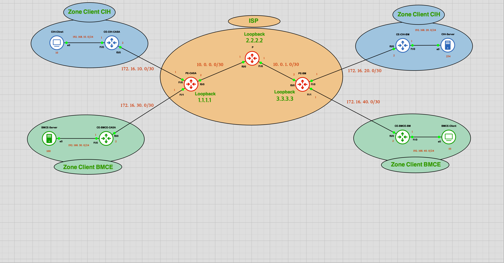
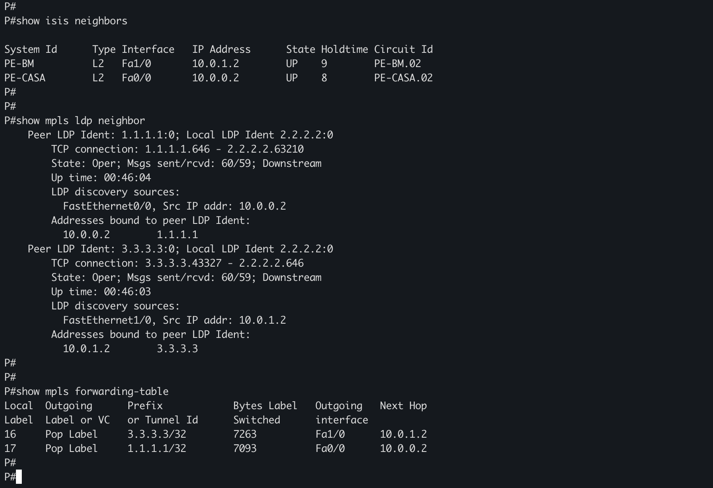
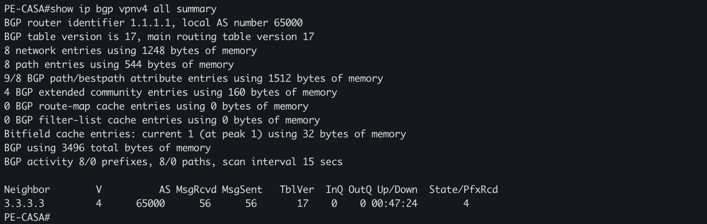
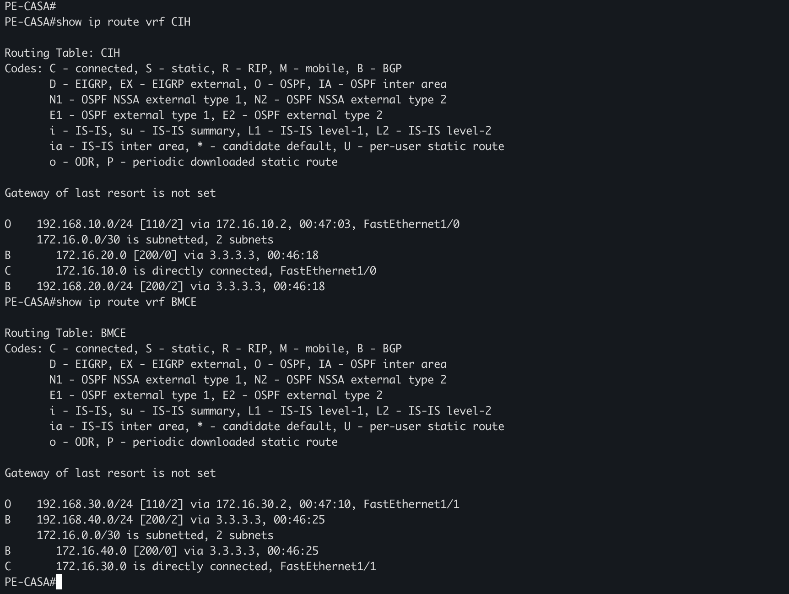
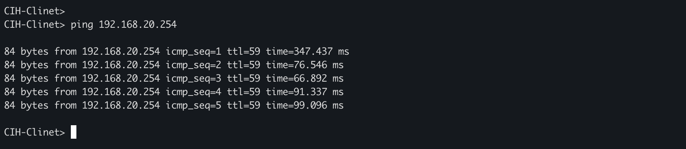
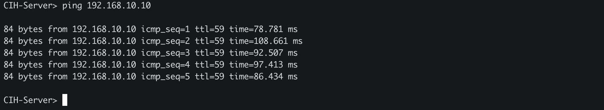
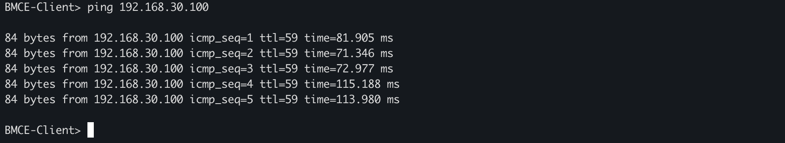
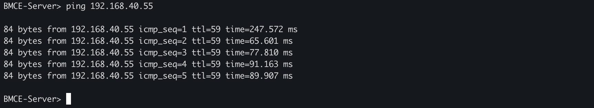

# MPLS L3VPN – Multi-Customer ISP Network

### VRF • IS-IS • MPLS • LDP • MP-BGP • OSPF • GNS3

A complete **MPLS Layer 3 VPN laboratory** simulating a service-provider network that connects multiple customer sites through a shared MPLS backbone while maintaining complete routing isolation between customers.

The project was designed, configured, tested, and documented using **GNS3 and Cisco IOS**.

---

## 📖 Project Overview

This project demonstrates the implementation of a **Multi-Protocol Label Switching Layer 3 VPN — MPLS L3VPN** architecture for an Internet Service Provider.

Two customers share the same provider infrastructure:

- **CIH**
- **BMCE**

Each customer has two geographically separated sites:

- Casablanca
- Beni Mellal

The provider network consists of:

- **2 Provider Edge routers — PE**
- **1 Provider Core router — P**
- **4 Customer Edge routers — CE**

A total of **7 routers** are used.

The main objective is to demonstrate how an ISP can transport multiple customer networks over the same MPLS backbone while keeping their routing information completely separated using **VRF**.

---

## 🎯 Project Objectives

The laboratory implements the following concepts:

- Build an ISP MPLS backbone.
- Connect multiple customer sites through a shared provider infrastructure.
- Separate customer routing tables using **VRF**.
- Configure **IS-IS** as the provider Interior Gateway Protocol.
- Enable **MPLS** forwarding in the provider core.
- Use **LDP** for MPLS label distribution.
- Configure **MP-BGP VPNv4** between PE routers.
- Use **OSPF** between CE and PE routers.
- Redistribute routes between OSPF and BGP.
- Configure **Route Distinguisher — RD**.
- Configure **Route Target — RT**.
- Verify MPLS label forwarding.
- Verify MP-BGP VPNv4 route exchange.
- Verify customer VRF routing tables.
- Test end-to-end connectivity between remote customer sites.
- Maintain complete logical separation between CIH and BMCE.

---

# 🏗️ Network Topology



The logical provider architecture is:

```text
                         MPLS ISP BACKBONE
                              AS 65000

                    10.0.0.0/30       10.0.1.0/30

               PE-CASA ---------- P ---------- PE-BM
              1.1.1.1/32       2.2.2.2       3.3.3.3/32
                 /   \                            /   \
                /     \                          /     \
               /       \                        /       \
      CE-CIH-CASA   CE-BMCE-CASA       CE-CIH-BM   CE-BMCE-BM
           |              |                 |             |
     192.168.10.0    192.168.30.0     192.168.20.0   192.168.40.0
          /24             /24                /24            /24
```

---

# 🖧 Router Roles

| Device | Role | Function |
|---|---|---|
| **PE-CASA** | Provider Edge | VRF, OSPF, IS-IS, MPLS/LDP, MP-BGP |
| **P** | Provider Core | IS-IS, MPLS/LDP |
| **PE-BM** | Provider Edge | VRF, OSPF, IS-IS, MPLS/LDP, MP-BGP |
| **CE-CIH-CASA** | Customer Edge | CIH Casablanca |
| **CE-CIH-BM** | Customer Edge | CIH Beni Mellal |
| **CE-BMCE-CASA** | Customer Edge | BMCE Casablanca |
| **CE-BMCE-BM** | Customer Edge | BMCE Beni Mellal |

The **P router does not contain customer VRFs** and does not participate in customer OSPF or MP-BGP VPNv4 routing.

It only provides MPLS transport through the provider backbone.

---

# 🌍 Autonomous System

The ISP uses:

```text
AS 65000
```

AS 65000 is used as the provider's private BGP Autonomous System in this laboratory.

The two Provider Edge routers establish an **MP-iBGP** session:

```text
PE-CASA                              PE-BM
1.1.1.1                              3.3.3.3
AS 65000                              AS 65000

             MP-BGP VPNv4
        <-------------------->
```

Because both routers belong to the same AS, the BGP relationship is **iBGP**.

---

# 📡 IP Addressing Plan

## Provider Backbone

| Device | Interface | IP Address | Purpose |
|---|---|---|---|
| PE-CASA | Loopback0 | `1.1.1.1/32` | Router ID / LDP / MP-BGP |
| PE-CASA | FastEthernet0/0 | `10.0.0.2/30` | Link to P |
| P | Loopback0 | `2.2.2.2/32` | Router ID / LDP |
| P | FastEthernet0/0 | `10.0.0.1/30` | Link to PE-CASA |
| P | FastEthernet1/0 | `10.0.1.1/30` | Link to PE-BM |
| PE-BM | Loopback0 | `3.3.3.3/32` | Router ID / LDP / MP-BGP |
| PE-BM | FastEthernet0/0 | `10.0.1.2/30` | Link to P |

Provider links:

```text
PE-CASA ↔ P       10.0.0.0/30
P ↔ PE-BM         10.0.1.0/30
```

---

# 🏦 CIH Customer

## Casablanca Site

| Device | Interface | IP Address |
|---|---|---|
| PE-CASA | FastEthernet1/0 | `172.16.10.1/30` |
| CE-CIH-CASA | FastEthernet0/0 | `172.16.10.2/30` |
| CE-CIH-CASA | FastEthernet1/0 | `192.168.10.1/24` |
| CIH Client | — | `192.168.10.10/24` |

LAN:

```text
192.168.10.0/24
```

Gateway:

```text
192.168.10.1
```

---

## Beni Mellal Site

| Device | Interface | IP Address |
|---|---|---|
| PE-BM | FastEthernet1/0 | `172.16.20.1/30` |
| CE-CIH-BM | FastEthernet0/0 | `172.16.20.2/30` |
| CE-CIH-BM | FastEthernet1/0 | `192.168.20.1/24` |
| CIH Server | — | `192.168.20.254/24` |

LAN:

```text
192.168.20.0/24
```

Gateway:

```text
192.168.20.1
```

---

# 🏦 BMCE Customer

## Casablanca Site

| Device | Interface | IP Address |
|---|---|---|
| PE-CASA | FastEthernet1/1 | `172.16.30.1/30` |
| CE-BMCE-CASA | FastEthernet0/0 | `172.16.30.2/30` |
| CE-BMCE-CASA | FastEthernet1/0 | `192.168.30.1/24` |
| BMCE Server | — | `192.168.30.100/24` |

LAN:

```text
192.168.30.0/24
```

Gateway:

```text
192.168.30.1
```

---

## Beni Mellal Site

| Device | Interface | IP Address |
|---|---|---|
| PE-BM | FastEthernet1/1 | `172.16.40.1/30` |
| CE-BMCE-BM | FastEthernet0/0 | `172.16.40.2/30` |
| CE-BMCE-BM | FastEthernet1/0 | `192.168.40.1/24` |
| BMCE Client | — | `192.168.40.55/24` |

LAN:

```text
192.168.40.0/24
```

Gateway:

```text
192.168.40.1
```

---

# 🔐 VRF — Virtual Routing and Forwarding

VRF allows multiple independent routing tables to exist on the same Provider Edge router.

Two VRFs are configured:

```text
CIH
BMCE
```

This allows both customers to use the same provider backbone while maintaining completely separate routing environments.

---

## CIH VRF

```cisco
ip vrf CIH
 rd 65000:1
 route-target export 65000:1
 route-target import 65000:1
```

---

## BMCE VRF

```cisco
ip vrf BMCE
 rd 65000:2
 route-target export 65000:2
 route-target import 65000:2
```

---

# 🏷️ RD and RT

## Route Distinguisher — RD

The **Route Distinguisher** makes customer VPN routes unique when they are transported through MP-BGP.

| Customer | RD |
|---|---|
| CIH | `65000:1` |
| BMCE | `65000:2` |

The RD itself does **not configure the BGP Autonomous System**.

The BGP AS is configured separately:

```cisco
router bgp 65000
```

---

## Route Target — RT

Route Targets control which VPN routes are exported and imported by each VRF.

| Customer | Export RT | Import RT |
|---|---|---|
| CIH | `65000:1` | `65000:1` |
| BMCE | `65000:2` | `65000:2` |

This ensures that CIH routes remain inside the CIH VPN and BMCE routes remain inside the BMCE VPN.

---

# 🛰️ IS-IS Provider Backbone

**IS-IS — Intermediate System to Intermediate System** is used as the provider Interior Gateway Protocol.

It provides IP connectivity between:

```text
PE-CASA
   |
   P
   |
PE-BM
```

The provider loopbacks are advertised through IS-IS:

```text
PE-CASA → 1.1.1.1/32
P       → 2.2.2.2/32
PE-BM   → 3.3.3.3/32
```

These loopback addresses provide stable router identities and are used by LDP and MP-BGP.

---

## IS-IS NET Addresses

```text
PE-CASA
49.0001.0000.0000.0001.00

P
49.0001.0000.0000.0002.00

PE-BM
49.0001.0000.0000.0003.00
```

All provider routers operate as:

```cisco
is-type level-2-only
```

Example:

```cisco
router isis CORE
 net 49.0001.0000.0000.0001.00
 is-type level-2-only
```

IS-IS is enabled directly on provider interfaces:

```cisco
interface Loopback0
 ip router isis CORE

interface FastEthernet0/0
 ip router isis CORE
```

---

# 🏷️ MPLS

**MPLS — Multi-Protocol Label Switching** forwards traffic using labels rather than relying only on traditional IP lookup at every hop.

The MPLS forwarding path is:

```text
PE-CASA -------- P -------- PE-BM
```

MPLS is enabled only on provider-facing core links.

Example:

```cisco
interface FastEthernet0/0
 mpls ip
```

MPLS is not required on the CE-facing customer interfaces.

---

# 🔄 LDP — Label Distribution Protocol

LDP distributes MPLS labels between provider routers.

Global configuration:

```cisco
mpls label protocol ldp
mpls ldp router-id Loopback0 force
```

The loopback interface is used as the LDP router ID.

Verification:

```cisco
show mpls ldp neighbor
```

---

# 📚 RIB, LIB and LFIB

The MPLS forwarding process involves several tables.

## RIB — Routing Information Base

Contains IP routes learned from routing protocols such as IS-IS.

## LIB — Label Information Base

Contains MPLS label bindings learned and generated through LDP.

## LFIB — Label Forwarding Information Base

Contains the MPLS forwarding information actually used to switch labeled packets.

Conceptually:

```text
IS-IS
  │
  ▼
 RIB
  │
  ▼
 LDP
  │
  ▼
 LIB
  │
  ▼
 LFIB
  │
  ▼
MPLS Forwarding
```

---

# 🔖 MPLS Label Header

An MPLS label entry contains **32 bits**.

```text
+----------------------+--------+---+----------+
| Label — 20 bits      | TC — 3 | S | TTL — 8 |
+----------------------+--------+---+----------+
```

| Field | Size | Function |
|---|---:|---|
| Label | 20 bits | MPLS forwarding value |
| TC | 3 bits | Traffic Class / QoS |
| S | 1 bit | Bottom of Stack |
| TTL | 8 bits | Loop prevention |

For the **S bit**:

```text
S = 1 → Last label in the stack
S = 0 → Additional MPLS labels exist below
```

---

# 🔄 MPLS Label Operations

MPLS uses three main forwarding operations:

```text
PUSH
SWAP
POP
```

## PUSH

The ingress PE adds one or more MPLS labels.

```text
IP Packet
   ↓
PE-CASA
   ↓
PUSH
   ↓
MPLS Packet
```

## SWAP

A transit MPLS router replaces the incoming transport label with the outgoing label.

```text
Incoming Label
      ↓
      P
      ↓
Outgoing Label
```

## POP

The outer MPLS transport label is removed near the egress PE.

This can occur through **Penultimate Hop Popping — PHP**, where the P router removes the transport label before sending the packet to the egress PE.

---

# 🌐 MP-BGP VPNv4

**MP-BGP — Multiprotocol Border Gateway Protocol** extends BGP to support multiple address families.

In this project, it is used to exchange:

```text
VPNv4 routes
```

between:

```text
PE-CASA ↔ PE-BM
```

The P router does not participate in MP-BGP.

---

## PE-CASA MP-BGP

```cisco
router bgp 65000
 no synchronization
 bgp log-neighbor-changes

 neighbor 3.3.3.3 remote-as 65000
 neighbor 3.3.3.3 update-source Loopback0

 no auto-summary

 address-family vpnv4
  neighbor 3.3.3.3 activate
  neighbor 3.3.3.3 send-community extended
 exit-address-family
```

---

## PE-BM MP-BGP

```cisco
router bgp 65000
 no synchronization
 bgp log-neighbor-changes

 neighbor 1.1.1.1 remote-as 65000
 neighbor 1.1.1.1 update-source Loopback0

 no auto-summary

 address-family vpnv4
  neighbor 1.1.1.1 activate
  neighbor 1.1.1.1 send-community extended
 exit-address-family
```

The extended communities carry the Route Target information associated with VPN routes.

---

# 🔁 BGP, iBGP, eBGP and MP-BGP

## BGP

**BGP — Border Gateway Protocol** is used to exchange routing information between BGP-speaking routers.

---

## eBGP

**External BGP** is normally used between routers located in different Autonomous Systems.

```text
AS 65000 ←──── eBGP ────→ AS 65100
```

---

## iBGP

**Internal BGP** is used between BGP routers belonging to the same Autonomous System.

```text
PE-CASA                  PE-BM
AS 65000                 AS 65000

       ←──── iBGP ────→
```

---

## MP-BGP

**Multiprotocol BGP** adds support for multiple address families.

Examples include:

```text
IPv4
IPv6
VPNv4
VPNv6
```

This laboratory uses the **VPNv4 address family**.

---

# 🛣️ OSPF CE–PE Routing

OSPF is used between the CE routers and PE routers.

Two OSPF processes are used:

| Customer | OSPF Process |
|---|---:|
| CIH | `10` |
| BMCE | `20` |

---

## CIH Casablanca

CE configuration:

```cisco
router ospf 10
 router-id 10.10.10.1
 log-adjacency-changes
 network 172.16.10.0 0.0.0.3 area 0
 network 192.168.10.0 0.0.0.255 area 0
```

PE configuration:

```cisco
router ospf 10 vrf CIH
 router-id 10.10.10.10
 log-adjacency-changes
 redistribute bgp 65000 subnets
 network 172.16.10.0 0.0.0.3 area 0
```

---

## CIH Beni Mellal

```cisco
router ospf 10
 router-id 10.10.20.1
 network 172.16.20.0 0.0.0.3 area 0
 network 192.168.20.0 0.0.0.255 area 0
```

---

## BMCE Casablanca

```cisco
router ospf 20
 router-id 20.20.30.1
 network 172.16.30.0 0.0.0.3 area 0
 network 192.168.30.0 0.0.0.255 area 0
```

---

## BMCE Beni Mellal

```cisco
router ospf 20
 router-id 20.20.40.1
 network 172.16.40.0 0.0.0.3 area 0
 network 192.168.40.0 0.0.0.255 area 0
```

---

# 🔄 Route Redistribution

Customer routes learned through OSPF must enter MP-BGP so that the remote PE can learn them.

On the PE routers:

```cisco
router bgp 65000

 address-family ipv4 vrf CIH
  redistribute connected
  redistribute ospf 10 vrf CIH
 exit-address-family

 address-family ipv4 vrf BMCE
  redistribute connected
  redistribute ospf 20 vrf BMCE
 exit-address-family
```

Remote BGP routes are redistributed back toward the CE routers:

```cisco
router ospf 10 vrf CIH
 redistribute bgp 65000 subnets
```

and:

```cisco
router ospf 20 vrf BMCE
 redistribute bgp 65000 subnets
```

---

# 🔗 How the Protocols Work Together

The complete control-plane relationship can be summarized as:

```text
Customer LAN
     │
     ▼
    OSPF
     │
     ▼
     CE
     │
     ▼
     PE
     │
     ├── VRF
     │    └── Separates customer routing tables
     │
     ├── MP-BGP
     │    └── Exchanges VPNv4 customer routes
     │
     └── MPLS
          └── Transports customer traffic through ISP
```

The provider transport plane operates as:

```text
IS-IS
  │
  └── Provides provider backbone reachability
          │
          ▼
         LDP
          │
          └── Distributes MPLS labels
                    │
                    ▼
                   MPLS
                    │
                    └── Forwards labeled traffic
```

---

# 🧠 Technology Summary

| Technology | Role |
|---|---|
| **VRF** | Separates customer routing tables |
| **RD** | Makes VPN routes unique |
| **RT** | Controls VPN route import/export |
| **OSPF** | Exchanges routes between CE and PE |
| **IS-IS** | Provides ISP backbone routing |
| **LDP** | Distributes MPLS labels |
| **MPLS** | Provides label-based forwarding |
| **MP-BGP** | Exchanges VPNv4 routes between PE routers |
| **iBGP** | BGP session inside AS 65000 |
| **VPNv4** | Carries customer VPN routes with RD information |

A simple way to understand the architecture is:

> **VRF separates the customers, IS-IS provides backbone connectivity, LDP distributes labels, MPLS transports packets, MP-BGP exchanges VPN routes between PE routers, and OSPF exchanges routes between CE and PE routers.**

---

# ✅ Verification

Several verification tests were performed after configuration.

---

## Provider Core Verification

The provider core successfully establishes IS-IS connectivity, LDP adjacencies, and MPLS forwarding information.



Useful commands:

```cisco
show isis neighbors
show ip route isis
show mpls ldp neighbor
show mpls forwarding-table
show mpls interfaces
```

---

## MP-BGP VPNv4 Verification

The MP-BGP VPNv4 session between the PE routers is successfully established inside AS 65000.



Verification commands:

```cisco
show ip bgp vpnv4 all summary
show ip bgp vpnv4 all
```

Depending on the IOS version:

```cisco
show bgp vpnv4 unicast all summary
```

---

## VRF Routing Tables

Both customer VRFs contain local routes learned through OSPF and remote routes learned through MP-BGP.



Verification:

```cisco
show ip vrf
show ip route vrf CIH
show ip route vrf BMCE
```

---

# 🧪 End-to-End Connectivity Tests

## CIH — Casablanca → Beni Mellal

Source:

```text
192.168.10.10
```

Destination:

```text
192.168.20.254
```



---

## CIH — Beni Mellal → Casablanca



Successful communication confirms that both CIH sites are connected through the MPLS L3VPN.

---

## BMCE — Beni Mellal → Casablanca

Source:

```text
192.168.40.55
```

Destination:

```text
192.168.30.100
```



---

## BMCE — Casablanca → Beni Mellal



Successful communication confirms that both BMCE sites are connected through their own MPLS VPN.

---

# 🔒 Customer Isolation

Although CIH and BMCE use the same physical MPLS infrastructure, their routing tables remain logically separated.

```text
                    Shared MPLS Backbone
                           │
               ┌───────────┴───────────┐
               │                       │
          VRF CIH                 VRF BMCE
               │                       │
        CIH customer routes      BMCE customer routes
```

Routes from one customer are not automatically imported into the VRF of the other customer.

This is one of the main advantages of MPLS L3VPN for service-provider networks.

---

# 📁 Repository Structure

```text
MPLS-L3VPN-Multi-Customer-ISP-Network/
│
├── README.md
├── .gitattributes
│
├── configs/
│   ├── PE-CASA.cfg
│   ├── P-Provider.cfg
│   ├── PE-BM.cfg
│   ├── CE-CIH-CASA.cfg
│   ├── CE-CIH-BM.cfg
│   ├── CE-BMCE-CASA.cfg
│   └── CE-BMCE-BM.cfg
│
├── topology/
│   └── Network-Topology.png
│
├── screenshots/
│   ├── provider-core-verification.png
│   ├── mp-bgp-vpnv4-summary.png
│   ├── vrf-routing-tables.png
│   ├── cih-client-to-server-ping.png
│   ├── cih-server-to-client-ping.png
│   ├── bmce-client-to-server-ping.png
│   └── bmce-server-to-client-ping.png
│
├── documentation/
│   ├── addressing-table.md
│   ├── MPLS — Multi-Protocol Label Switching.pptx
│   └── MPLS_L3VPN_Full_Router_Configuration.pdf
│
└── gns3-project/
    └── MPLS-L3VPN-Project.gns3project
```

---

# 📄 Documentation

Additional project documentation is available in the `documentation` directory.

### IP Addressing Table

[View the complete IP addressing table](documentation/addressing-table.md)

### MPLS Presentation

[Download the MPLS L3VPN Presentation](documentation/MPLS%20%E2%80%94%20Multi-Protocol%20Label%20Switching.pptx)

### Full Router Configuration

[Download the Full Router Configuration PDF](documentation/MPLS_L3VPN_Full_Router_Configuration.pdf)

---

# 🧪 GNS3 Project

The complete GNS3 laboratory project is available in this repository.

[Download the GNS3 MPLS L3VPN Project](gns3-project/MPLS-L3VPN-Project.gns3project)

The GNS3 project is stored using **Git Large File Storage — Git LFS** because of its size.

To clone the repository with the large GNS3 project file:

```bash
git lfs install
git clone https://github.com/khalidhrch1/MPLS-L3VPN-Multi-Customer-ISP-Network.git
```

Then open:

```text
gns3-project/MPLS-L3VPN-Project.gns3project
```

in GNS3.

A compatible local GNS3/Cisco IOS environment may be required to run the topology.

---

# ⚙️ Router Configurations

Individual router configurations are available in the `configs` directory.

### Provider Routers

- [PE-CASA](configs/PE-CASA.cfg)
- [P Provider](configs/P-Provider.cfg)
- [PE-BM](configs/PE-BM.cfg)

### CIH Customer Routers

- [CE-CIH-CASA](configs/CE-CIH-CASA.cfg)
- [CE-CIH-BM](configs/CE-CIH-BM.cfg)

### BMCE Customer Routers

- [CE-BMCE-CASA](configs/CE-BMCE-CASA.cfg)
- [CE-BMCE-BM](configs/CE-BMCE-BM.cfg)

---

# 🔍 Useful Verification Commands

## IS-IS

```cisco
show isis neighbors
show ip route isis
```

## MPLS

```cisco
show mpls interfaces
show mpls forwarding-table
```

## LDP

```cisco
show mpls ldp neighbor
show mpls ldp bindings
```

## MP-BGP VPNv4

```cisco
show ip bgp vpnv4 all summary
show ip bgp vpnv4 all
```

## VRF

```cisco
show ip vrf
show ip route vrf CIH
show ip route vrf BMCE
```

## OSPF

```cisco
show ip ospf neighbor
show ip route ospf
```

---

# 🛠️ Tools Used

- **GNS3**
- **Cisco IOS**
- **Git**
- **GitHub**
- **Git LFS**

---

# 📚 Technologies Covered

```text
MPLS
MPLS L3VPN
VRF
Route Distinguisher
Route Target
IS-IS
LDP
RIB
LIB
LFIB
BGP
iBGP
MP-BGP
VPNv4
OSPF
Route Redistribution
Penultimate Hop Popping
```

---

# 🚀 Possible Future Improvements

The current laboratory can be extended with:

- Redundant P and PE routers.
- MPLS Fast Reroute — FRR.
- MPLS Traffic Engineering.
- QoS implementation.
- IPv6 and VPNv6.
- eBGP as a CE–PE routing protocol.
- BGP Route Reflectors.
- Redundant customer links.
- Network monitoring.
- SNMP / telemetry.
- Python network automation.
- Ansible configuration automation.
- Link-failure testing.
- Convergence measurements.
- Additional customer VRFs.

---

# 🎓 Educational Purpose

This project was created for educational and laboratory purposes.

It demonstrates how service providers can use **MPLS L3VPN** to connect geographically separated customer networks through a shared backbone while maintaining independent routing environments for every customer.

The project combines both theoretical concepts and practical configuration of:

```text
Customer Routing
       ↓
      OSPF
       ↓
       VRF
       ↓
    MP-BGP
       ↓
VPNv4 Route Exchange

Provider Routing
       ↓
      IS-IS
       ↓
       LDP
       ↓
      MPLS
       ↓
Label-Based Transport
```

---

# 👨‍💻 Author

**Khalid HARCHAOUI**

Computer Networking & Digital Infrastructure Student

### Areas of Interest

- Network Engineering
- Routing & Switching
- Cisco Technologies
- MPLS
- Service Provider Networks
- Network Automation
- Cybersecurity

---

## ⭐ Project Summary

This laboratory demonstrates a complete working **MPLS L3VPN multi-customer ISP architecture**.

```text
VRF      → Customer isolation
OSPF     → CE–PE route exchange
IS-IS    → Provider backbone routing
LDP      → MPLS label distribution
MPLS     → Label-based transport
MP-BGP   → VPNv4 route exchange
RD / RT  → VPN route identification and control
```

The result is a shared provider backbone capable of transporting multiple independent customer VPNs while maintaining routing isolation between them.
